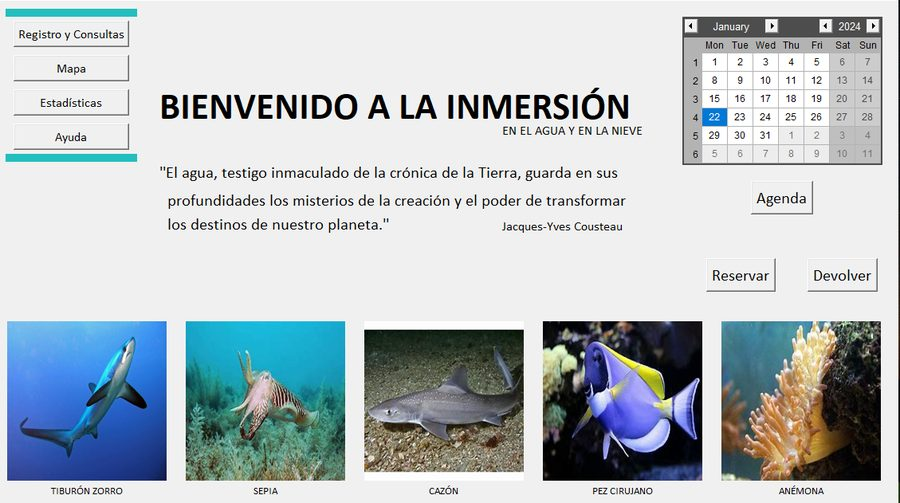
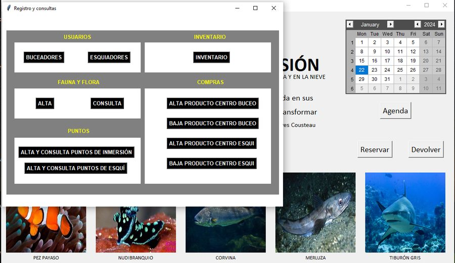
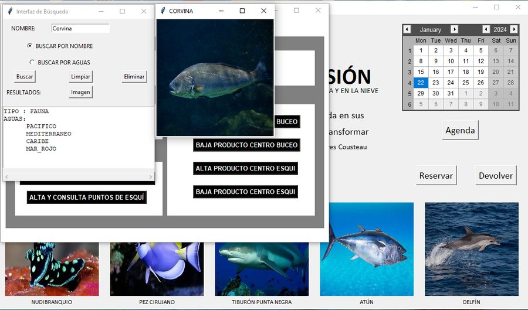
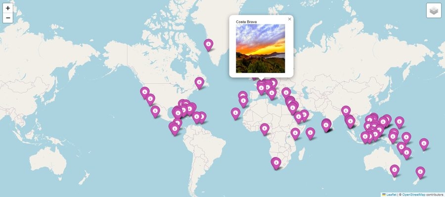
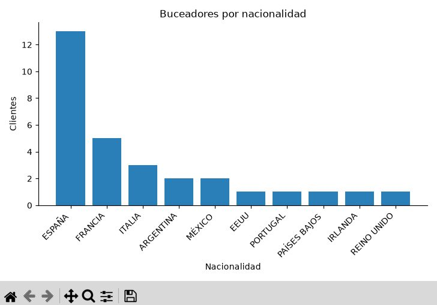

# ETSIIVIAJES

Aplicación de escritorio en Python para gestionar una agencia de turismo de **buceo y esquí**: clientes, inventario de material por país, reservas y devoluciones, facturas en PDF, un mapa mundial con 141 puntos de buceo y esquí, una base de datos de 58 especies marinas y un panel de estadísticas con *machine learning*.

Es el trabajo final de la asignatura **Programación en Python** del Grado en Ingeniería en Tecnologías Industriales (ETSII-UPM), curso 2023-24, revisado y reorganizado en 2026 para publicarlo.

Más proyectos en **[www.mboulman.com](https://www.mboulman.com)** · **[mboulman.es](https://mboulman.es)**.



▶️ **[Ver el vídeo de presentación (1:30)](https://youtu.be/6E6xAiBmt2w)**

## Qué hace

| Módulo | Funcionalidad |
| --- | --- |
| Clientes | Alta, consulta y baja de buceadores y esquiadores, con validación del DNI/NIE (letra de control), email, peso y altura, y foto. |
| Fauna y flora | Alta y consulta de especies y de las aguas en las que se han visto (7 mares y océanos), con foto. |
| Puntos | Puntos de inmersión (país, coordenadas, aguas, profundidad, foto) y estaciones de esquí (km de pistas, mapa). |
| Inventario y compras | Stock por país, actividad, equipo y talla. Las bajas no pueden dejar el stock en negativo. |
| Reservas | Comprueba que haya stock de **todo** el equipo, lo resta y guarda la venta en una única transacción. Genera la factura (base + IVA = total) y un PDF con la fauna de las aguas del país. |
| Devoluciones | Devuelve al inventario la última reserva pendiente de un cliente; una reserva no se puede devolver dos veces. |
| Mapa | Mapa interactivo con Folium y una capa por actividad. |
| Estadísticas | Edades, nacionalidades y niveles; segmentación de clientes con **K-means**; gasto por país, actividad y talla; predicción del importe con **regresión lineal** (mostrando su R²). |
| Agenda | Cursos y competiciones guardados en la base de datos. |

| | |
| --- | --- |
|  |  |
|  |  |

## Tecnologías

Python 3.10+, Tkinter y tkcalendar (interfaz), SQLite (datos), pandas, scikit-learn y matplotlib (análisis), Folium (mapa), ReportLab (PDF), OpenCV (vídeo de fondo del mapa), Faker (datos de demostración) y pytest (pruebas).

## Instalación y uso

```bash
git clone https://github.com/MBoulman/etsiiviajes.git
cd etsiiviajes
python -m venv .venv
# Windows: .venv\Scripts\activate   ·   macOS/Linux: source .venv/bin/activate
pip install -r requirements.txt
python main.py
```

La primera vez, la aplicación crea `datos/etsiiviajes.db` a partir del catálogo (`datos/catalogo.db`) y la rellena con 60 clientes y 45 reservas inventados. Para empezar de cero basta con borrar ese archivo. Las facturas, los PDF y el mapa se guardan en `salida/`.

En Linux, Tkinter se instala aparte (`sudo apt install python3-tk`).

## Datos de demostración

Ningún dato de cliente es real. Los clientes, las reservas y los eventos los genera `etsiiviajes/datos_demo.py` con Faker. Los documentos de identidad tienen la forma `DEMO00001`, los teléfonos `600 000 0xx` y los correos usan el dominio reservado `example.com`. Para probar una reserva, usa por ejemplo el DNI `DEMO00001` (buceador) o `DEMO00002` (esquiador).

El catálogo (puntos de buceo y esquí, especies e inventario inicial) se elaboró para el trabajo a partir de información pública.

## Estructura

```
main.py                      punto de entrada
etsiiviajes/
├── config.py                rutas y constantes (tallas, equipos, aguas, IVA)
├── modelos.py               dataclasses: Usuario, Buzo, Esquiador, Alquiler, Venta...
├── gestor.py                acceso a SQLite (una sola base de datos, consultas parametrizadas)
├── documentos.py            precio, factura e informe de especies en PDF
├── estadisticas.py          análisis con pandas y scikit-learn
├── mapa.py                  mapa con Folium
├── datos_demo.py            genera la base de trabajo con datos ficticios
├── utils.py                 validaciones, fechas, imágenes y apertura de archivos
└── ui/                      una ventana por archivo (Tkinter)
datos/catalogo.db            catálogo de referencia
assets/                      iconos, fotos y vídeo
tests/                       pruebas con pytest
```

## Pruebas

```bash
pytest
```

Las pruebas cubren las reservas (stock insuficiente sin cambios parciales), las devoluciones, las compras y bajas, la validación de DNI y email, el desglose del IVA, la numeración de facturas y la generación de los datos de demostración y del modelo.

## Cambios respecto a la entrega original (2024)

- Rutas relativas al proyecto: antes la aplicación solo funcionaba en el ordenador en el que se programó.
- Una sola ventana raíz de Tkinter: antes cada ventana se abría como un proceso de Python aparte.
- Una única base de datos con transacciones; las imágenes del catálogo se han comprimido (de 82 MB a 5 MB).
- Corregidos el cálculo del IVA, el precio de la factura, la numeración de facturas, las devoluciones repetidas, el stock negativo y la presentación de los resultados de búsqueda.
- Validación de entradas y lista cerrada de los nombres de columna que se componen en el SQL.
- Pruebas automáticas, `requirements.txt` y datos de demostración ficticios.

## Autores
- Mohamed Boulman Mokhlis ([www.mboulman.com](https://www.mboulman.com) · [mboulman.es](https://mboulman.es))
- Sofía Veldman Paniego
- Juan del Junco Sampol


## Imágenes

Las fotografías de especies y lugares se usan con fines educativos y pertenecen a sus autores. Si eres el autor de alguna y quieres que se retire, abre un *issue*.
